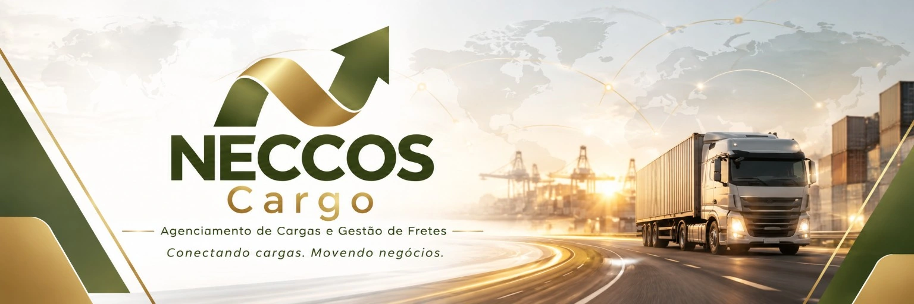
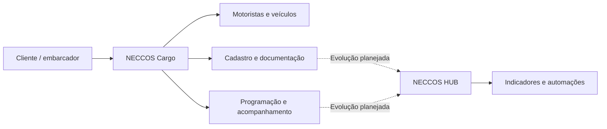

  

<h1 align="center">NECCOS Cargo</h1>

<strong>Conectando cargas. Movendo negócios.</strong>

Agenciamento de Cargas e Gestão de Fretes • Osasco, São Paulo

  <a href="https://neccos-cargo.joasmaciel588.workers.dev/">🌐 Site institucional publicado</a> ·
  <a href="docs/proposta-parcerias.md">🤝 Proposta de parcerias</a> ·
  <a href="docs/00-resumo-executivo.md">📌 Resumo executivo</a> ·
  <a href="docs/07-proposta-parcerias-investimento.md">🤝 Proposta para parceiros</a> ·
  <a href="docs/06-neccos-hub.md">💻 NECCOS HUB</a>

> **Status — 30/10/2026:** projeto empresarial em estruturação e validação. O site institucional está publicado em endereço gratuito. O domínio próprio e os e-mails corporativos ainda não foram ativados. Este repositório apresenta um **plano de negócio e de produto**, não afirma que a empresa já possui CNPJ, contratos ativos, faturamento ou software concluído.

## A oportunidade

O transporte rodoviário de cargas depende de coordenação entre embarcadores, transportadoras e motoristas: encontrar capacidade disponível, negociar condições, validar documentos, programar coletas, acompanhar cada etapa e organizar repasses. A NECCOS propõe simplificar esse fluxo com **agenciamento operacional especializado** e, progressivamente, tecnologia.

## O que estamos construindo

**1. NECCOS Cargo — operação de agenciamento:** conexão entre demandas de frete e motoristas/veículos aptos; suporte ao cadastro, programação, negociação e documentação, sempre conforme contratos e requisitos aplicáveis.

**2. NECCOS HUB — plataforma futura:** sistema próprio de gestão de fretes para consolidar cadastros, solicitações, alocações, status, documentos e indicadores. A arquitetura será desenhada e testada em etapas, com automações e integrações quando fizerem sentido.

## Estágio atual e próximas validações

| Frente | Situação em outubro de 2026 |
|---|---|
| Marca, identidade visual e site | **Concluídos / publicado em endereço gratuito** |
| Planejamento empresarial | **Em estruturação neste repositório** |
| Rede inicial de veículos | **Base informada de 5 veículos (2 VUC e 3 Truck); disponibilidade e documentação devem ser validadas por operação** |
| Prospecção e clientes pagantes | **Em validação; não são divulgados contratos ou faturamento confirmados** |
| Formalização e domínio próprio | **Pendentes** |
| E-mails corporativos | **Planejados, ainda inativos** |
| NECCOS HUB | **Conceito e arquitetura inicial; não é um produto entregue** |

## Explore os documentos

| Documento | Conteúdo |
|---|---|
| [Resumo executivo](docs/00-resumo-executivo.md) | Negócio, objetivo, estágio e próximos marcos |
| [Tese e proposta de valor](docs/01-problema-e-solucao.md) | Dor do mercado e proposta comercial |
| [Modelo de negócios](docs/02-modelo-de-negocios.md) | Clientes, receita, atividades e recursos |
| [Operação e jornada do frete](docs/03-fluxo-operacional.md) | Processo operacional proposto |
| [Estratégia de validação comercial](docs/04-validacao-e-vendas.md) | Como conquistar e medir primeiros clientes |
| [Roadmap](docs/05-roadmap.md) | Plano de evolução com critérios para avançar |
| [NECCOS HUB](docs/06-neccos-hub.md) | Visão, módulos, dados e arquitetura |
| [Parcerias e investimento](docs/07-proposta-parcerias-investimento.md) | Necessidades, formatos de parceria e uso potencial de recursos |
| [Modelo econômico](docs/08-modelo-economico.md) | Fórmulas e cenários **ilustrativos**, não projeções |
| [Riscos e conformidade](docs/09-riscos-e-conformidade.md) | Pendências legais, de segurança e operação |
| [Pitch de três minutos](docs/10-pitch-3-minutos.md) | Texto de apresentação oral |
| [Plano de ação](docs/11-plano-de-acao.md) | Lista de prioridades executáveis |

## Site e tecnologia

O site institucional pode ser acessado em **[NECCOS Cargo](https://neccos-cargo.joasmaciel588.workers.dev/)**. Seu HTML/CSS/JS estão em [`website/index.html`](website/index.html), com [guia técnico](website/GUIA-IMPLANTACAO.md). As imagens ainda estão hospedadas na Cloudflare e o código espelhado no GitHub as referencia por URL absoluta. Para nova implantação com autonomia, guarde o ZIP original completo. O próximo passo comercial é registrar o domínio próprio quando houver orçamento; o site pode continuar funcionando sem isso.

A construção do NECCOS HUB será orientada por necessidades reais de operação. Ferramentas em estudo incluem **Excel / planilhas, SQL, Python, Power BI e n8n**. Nenhuma integração deve ser considerada concluída apenas por estar documentada aqui.

## Conversar sobre parceria

Buscamos conversar com **potenciais clientes, transportadoras, motoristas e parceiros estratégicos** para validar demandas e desenvolver uma operação sustentável. Entre em contato pelo WhatsApp disponível no [site institucional](https://neccos-cargo.joasmaciel588.workers.dev/#contato).

**Responsável pelo projeto:** Joás Maciel Naves.

---

> **Aviso:** conteúdo público de planejamento, para discussão e validação. Não constitui proposta vinculante, oferta pública de investimento, promessa de rentabilidade ou comprovação de operações realizadas. Informações financeiras são hipóteses a validar. Materiais comerciais, dados pessoais de motoristas, tabelas de clientes, senhas e contratos privados **não devem ser publicados** aqui.