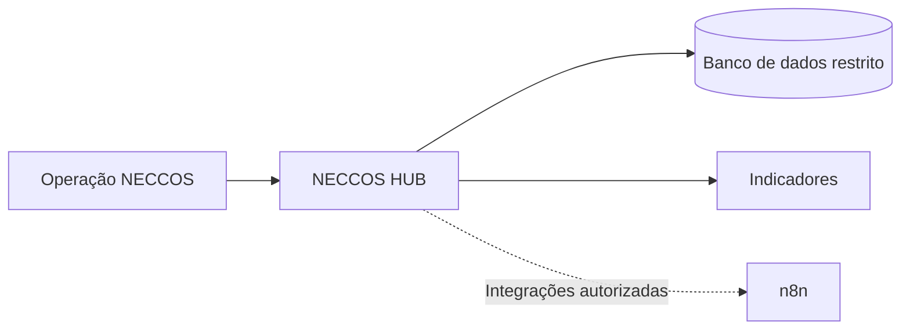

# NECCOS HUB — visão tecnológica

**Status:** conceito em estruturação, ainda sem sistema em produção.

## Objetivo
Um TMS (Transportation Management System) próprio para organizar demandas de frete, motoristas, veículos, alocações, documentos, acompanhamento e indicadores.

| Módulo planejado | Função |
|---|---|
| Clientes | Cadastro empresarial e relacionamento |
| Motoristas / veículos | Cadastro restrito, homologação e controle documental |
| Demandas | Origem, destino, janela, carga e tipo de veículo |
| Alocação | Consulta, oferta e aceite |
| Operação | Status e ocorrências |
| Financeiro | Registros, conferências e conciliação |
| BI | Tempo de resposta, conversão, custos e margens |

## Ferramentas em estudo
Excel, Python, SQL, Power BI e n8n. Obsidian é base de conhecimento; GitHub é controle de versões. Dados pessoais, contratos e credenciais não entram no código público.

O MVP somente deverá ser construído após validação operacional e análise de segurança/LGPD.